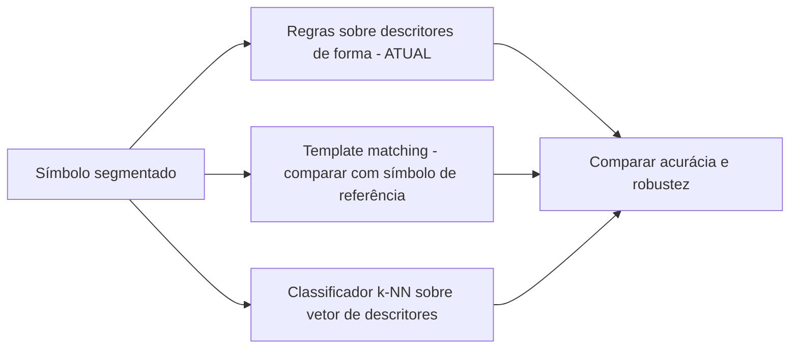
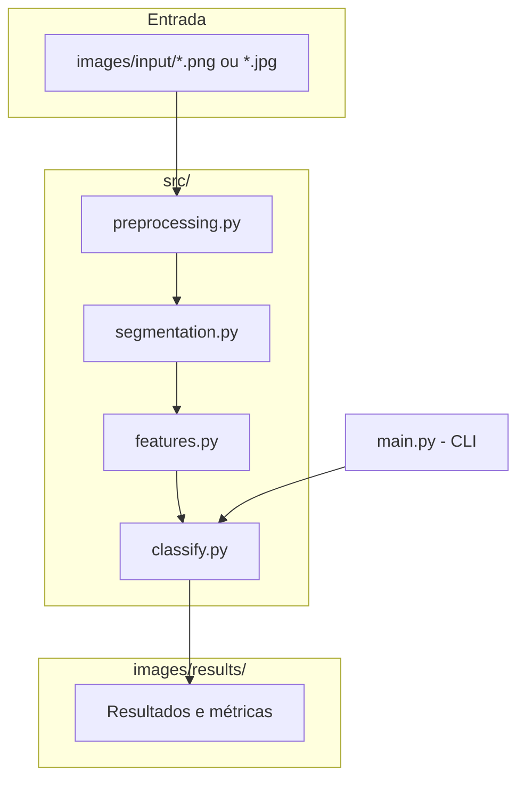

# Proposta — Identificação do Naipe em Cartas de Baralho

> **Revisão M2.** Esta proposta foi atualizada após a devolutiva da M1: imagens reais, segmentação do canto, divisão ajuste/teste e comparação de métodos. A resposta ponto a ponto à devolutiva e os resultados estão em [`relatorio_m2.md`](relatorio_m2.md). A versão da M1 fica no histórico do Git (commit `83500d1`).

## 7.1 Problema

O problema é: **dada uma foto de uma carta de baralho francês (52 cartas), identificar automaticamente a qual dos quatro naipes ela pertence — copas, ouros, paus ou espadas.**

Isso envolve processamento e análise de imagem porque a informação de naipe está codificada visualmente em dois atributos combinados:

- **cor** do símbolo impresso na carta (vermelho para copas/ouros, preto para paus/espadas);
- **forma** do símbolo (coração, losango, trevo, pique), que distingue os dois naipes dentro de cada cor.

**Situação inicial:** uma foto de uma carta individual, tirada de cima, com a carta inteira visível sobre a mesa; inclinação moderada é tolerada.

**Informação a ser produzida:** um rótulo entre `{copas, ouros, paus, espadas}`.

Delimitação explícita de escopo para a M1: o projeto identifica **apenas o naipe**, não o valor da carta (A, 2...K). Reconhecer o valor completo (13 classes, incluindo formas de números e figuras) é um problema mais amplo que poderá ser explorado como extensão nas etapas M2/M3, mas não faz parte do escopo atual.

## 7.2 Contexto de aplicação

Um contexto  para essa solução é a **automação de jogos de cartas** : uma câmera fixa acima de uma mesa de jogo (por exemplo, um app de mesa digital, um robô que organiza cartas, ou um assistente que lê cartas em voz alta) precisa identificar naipe e valor de cartas conforme elas são reveladas. Restringir o escopo da M1 a apenas o naipe permite validar a parte de segmentação e reconhecimento de forma/cor antes de acoplar o reconhecimento de valor, que é uma etapa adicional (mais classes, símbolos mais variados).

## 7.3 Objetivo

**Objetivo geral:** dado uma foto de uma carta de baralho francês, tirada com câmera fixa e carta centralizada, identificar corretamente o naipe da carta com alta acurácia.

**Objetivos específicos:**
- Implementar um pipeline de segmentação que isole o símbolo do naipe do fundo da carta.
- Extrair a cor dominante do símbolo (vermelho/preto).
- Extrair descritores de forma que distingam os dois naipes de cada cor.
- Combinar cor + forma em uma regra de classificação explicável (sem caixa-preta).
- Validar o pipeline com um conjunto inicial de imagens (sintéticas nesta fase de desenvolvimento; fotos reais do baralho físico como próximo passo imediato).

## 7.4 Entrada e saída esperadas

```
foto da carta (RGB)
   ↓
localização da carta (papel claro × fundo) e recorte do canto superior esquerdo
   ↓
binarização do canto (Otsu sobre min(R,G,B)) + morfologia opcional
   ↓
componentes conectados → valor (pode ter vários elementos) e símbolo do naipe
   ↓
cor dominante + descritores de forma (fill_ratio, simetria vertical, perfil de largura)
   ↓
classificação por regras calibradas no conjunto de ajuste
   ↓
resultado: naipe ∈ {copas, ouros, paus, espadas}
```

---

## 8. Imagens e dados

**Estado atual (M2):** 108 fotos reais do baralho físico do grupo em `images/input/reais/`: as 52 cartas fotografadas 2 vezes cada, mais 4 coringas. Celular, de cima, mesa de madeira, luz ambiente, 960 × 1280 px. Nomes no formato `naipe_valor_nn.jpg`.

- **Avaliação:** só com as fotos reais. As 20 imagens sintéticas da M1 continuam só como teste de regressão.
- **Divisão:** 64 fotos de ajuste e 40 de teste, estratificada por naipe e agrupada por carta, para que as duas fotos da mesma carta nunca fiquem separadas (`images/split_reais.json`).
- **Coringas:** ficam fora da avaliação de naipe e são usados como caso de falha esperada.
- **Restrições de uso:** baralho do grupo, sem restrição de redistribuição.

Detalhes do protocolo: seção 3 do [relatório da M2](relatorio_m2.md).

## 9. Pipeline preliminar


| Etapa | Finalidade | Técnica | Entrada | Saída | Situação na M2 |
|---|---|---|---|---|---|
| Localização da carta | Separar a carta do fundo | papel = `min(R,G,B) ≥ 115`, maior componente, preenchimento de buracos | RGB | máscara da carta | implementado |
| Recorte do canto | Isolar o índice (valor + símbolo) | região a partir do vértice superior esquerdo da carta | RGB + máscara | recorte do canto | implementado |
| Binarização e morfologia | Separar tinta do papel | Otsu manual sobre `min(R,G,B)`; abertura/fechamento opcionais | recorte | máscara de tinta | implementado; abertura avaliada com ruído |
| Componentes e seleção | Separar valor, símbolo e demais elementos | componentes conectados (8-viz.), filtros de área e borda, agrupamento por linha | máscara | caixas do valor e do naipe | implementado |
| Extração de forma | Diferenciar naipes da mesma cor | `fill_ratio`, `vertical_symmetry`, `width_profile_ratio` | máscara do símbolo | vetor de 3 descritores | implementado |
| Classificação | Decidir o naipe | regras calibradas no ajuste; template matching e k-NN comparados | cor + descritores | naipe | implementado; reconhecimento do valor pendente (M3) |

### Alternativas consideradas



Na M1 começamos pelas regras (B1), por serem explicáveis e não exigirem treinamento. Na M2 as três alternativas foram comparadas nas mesmas imagens (Experimento 3 do relatório). As três empatam em 100% nas fotos limpas, e o k-NN é o primeiro a errar com ruído. As regras foram mantidas.

## 10. Arquitetura preliminar



Organização de módulos (cada um com responsabilidade única, testável isoladamente):
- `preprocessing.py`: carregamento, conversão de espaço de cor, binarização (Otsu manual).
- `segmentation.py`: bounding box, recorte, detecção de cor dominante.
- `features.py`: descritores de forma.
- `classify.py`: combina os módulos anteriores e aplica a regra de decisão.
- `main.py`: ponto de entrada via linha de comando.
- `generate_synthetic_cards.py`: gerador de dados sintéticos de desenvolvimento (temporário, até termos fotos reais).

## 11. Viabilidade (atualizada na M2)

- **Pipeline completo em fotos reais:** roda sem ajuste manual por imagem e localiza valor e naipe nas 104 fotos com naipe.
- **Teste congelado:** com as regras calibradas só no ajuste, 40/40 fotos de teste corretas, com matriz de confusão por naipe publicada em `images/results/avaliacao_reais.json`.
- **Limiares da M1:** os limiares das sintéticas acertam só 23/40 nas fotos, o que confirma o alerta da M1 de que 100% nas sintéticas não estimava o desempenho real.
- **Testes automatizados:** cobrem segmentação, calibração, comparação e experimentos.

**Riscos para a M3:**
- um único baralho, fundo e luz;
- teste pequeno (5 cartas por naipe);
- segmentação frágil com ruído forte (σ = 60): localiza 27,5% dos símbolos sem morfologia e 60% com abertura.

## 12. Resultados

Os experimentos da M2 (limiares, morfologia com ruído e comparação de métodos) estão no [relatório da M2](relatorio_m2.md), seção 6.

## Próximos passos (para M3)

1. Fotografar um segundo conjunto, com outro fundo e outra luz, para teste externo.
2. Criar máscaras de referência manuais do símbolo e medir IoU/Dice.
3. Tornar a segmentação robusta a ruído forte.
4. Reconhecer o valor da carta, que já é localizado no canto.
5. Detectar o coringa como classe própria.

## Referências

- OpenCV / scikit-image docs sobre binarização e Otsu (consultadas para validar a implementação manual do método).
- Material da disciplina de Processamento de Imagens (2026-02), especialmente os laboratórios M1.1 e M1.2, que motivaram o cuidado com conversão explícita para RGB antes de qualquer operação em array.
