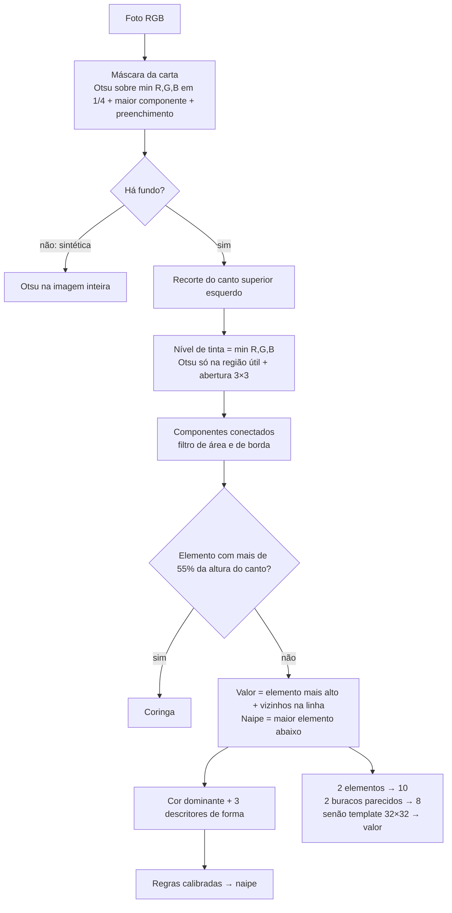
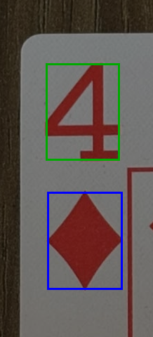
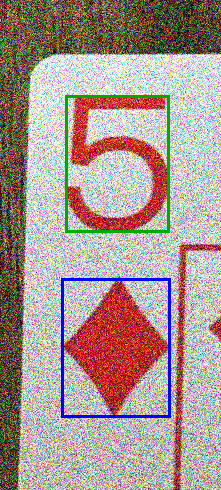
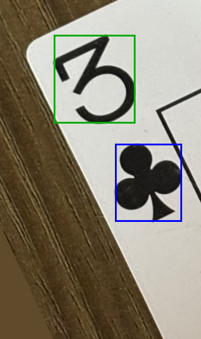

# Relatório final — Etapa M3

Projeto aplicado longitudinal — Processamento de Imagens, 2026-02.
Identificação do naipe e do valor em cartas de baralho.

Integrantes: Vinicius Lohn Ramires, Guilherme Cassettari e Guilherme Pires.

Registros das etapas anteriores: [relatório da M2](relatorio_m2.md), [README da M2](README_M2.md), [README da M1](README_M1.md) e [proposta](proposta.md).

## 1. Problema, contexto, objetivos e escopo final

Dada uma foto de uma carta de baralho francês, tirada de cima sobre uma mesa, o sistema identifica:

- o **naipe**: copas, ouros, espadas ou paus;
- o **valor**: A, 2–10, J, Q ou K;
- o **coringa**, como classe própria.

**Contexto:** automação de jogos de cartas. Uma câmera sobre a mesa identifica as cartas conforme são reveladas.

**Objetivo geral:** reconhecer naipe e valor a partir do índice do canto (valor + símbolo), com um pipeline clássico de PDI explicável, sem ajuste manual por imagem, e avaliado em dados que não orientaram o ajuste.

**Escopo final e mudanças:**

| Item | M1 | M2 | M3 (final) |
|---|---|---|---|
| Naipe | imagens sintéticas | fotos reais, canto da carta | igual à M2, com pré-processamento mais robusto |
| Valor | — | localizado, não reconhecido | **reconhecido** (template matching + regras estruturais) |
| Coringa | — | rejeitado com erro | **classe própria** |
| Pré-processamento do canto | Otsu na imagem inteira | Otsu no canto, sem morfologia | **abertura + limiar adaptativo da carta + Otsu só na região útil** |
| Avaliação | 20 sintéticas | 40 fotos de teste | 40 fotos de teste + máscaras de referência + ruído e condições simuladas |

O teste externo com fotos novas (outro fundo, outra luz), previsto no plano da M2, foi **substituído** por condições simuladas sobre as fotos de teste (Seção 3.5). Fica assim declarado que não houve teste com outro baralho nem com outro ambiente real.

**Critérios de sucesso:**

- acurácia e F1 por classe no conjunto de teste, para naipe e para valor;
- Dice/IoU por pixel do símbolo do naipe contra máscaras de referência;
- proporção de imagens corretas em cada condição degradada.

## 2. Fundamentação e fontes

| Técnica | Uso no projeto | Fonte |
|---|---|---|
| Limiarização de Otsu | separar tinta e papel no canto; separar carta e fundo (M3) | Otsu (1979); Gonzalez e Woods, cap. 10 |
| Componentes conectados (8-vizinhança) | elementos do canto, buracos do valor | Gonzalez e Woods, cap. 9 |
| Morfologia (abertura, cruz 3×3) | remover ruído pontual antes dos componentes | Gonzalez e Woods, cap. 9 |
| Filtro de mediana | candidato a remover ruído antes do Otsu (testado e não adotado) | Gonzalez e Woods, cap. 3 e 5 |
| Descritores de forma (ocupação, simetria, perfil de largura) | decisão do naipe | Gonzalez e Woods, cap. 11 |
| Template matching (diferença absoluta média) | decisão do valor | Gonzalez e Woods, cap. 12 |
| Número de buracos (topologia) | regra estrutural do 8 | Gonzalez e Woods, cap. 11 (número de Euler) |
| Dice e IoU | avaliar a segmentação | métricas usuais de segmentação |

Todas as operações estão implementadas no próprio projeto com NumPy. O Pillow é usado só para ler e gravar imagens, redimensionar, rotacionar (nas condições simuladas) e desenhar as figuras. Referências completas na Seção 12.

## 3. Dados, referências e protocolo de avaliação

### 3.1 Origem e aquisição

As fotos são as mesmas da M2, sem alterações:

- **Origem:** baralho físico de plástico de um integrante. Sem restrição de redistribuição; as fotos estão no repositório.
- **Aquisição:** celular, de cima, sobre mesa de madeira, com luz ambiente. Resolução 960 × 1280 px, JPEG.
- **Quantidade:** 108 fotos: 52 cartas × 2, mais 4 coringas. Ficam em `images/input/reais/`, com nome `naipe_valor_nn.jpg`.

### 3.2 Divisão ajuste/teste

A divisão da M2 foi mantida sem mudanças (`images/split_reais.json`, semente 42):

- **Ajuste:** 64 fotos (8 cartas por naipe).
- **Teste:** 40 fotos (5 cartas por naipe).
- As duas fotos da mesma carta ficam sempre no mesmo conjunto.

Tudo o que foi ajustado na M3 usou só o ajuste:

- os templates do valor;
- a escolha da configuração de ruído (Exp. 4);
- a escolha do limiar da carta (Exp. 6).

O teste foi usado apenas para medir.

### 3.3 Referências de avaliação

| Referência | Como foi obtida | Limite |
|---|---|---|
| Naipe e valor | rótulo manual no nome do arquivo, conferido visualmente | — |
| Máscara do símbolo (20 fotos de teste, as `_01`) | semi-automática e independente do pipeline: limiar **fixo** `min(R,G,B) ≤ 128` (sem Otsu), maior componente numa caixa ampliada em 20 px e buracos preenchidos; **todas conferidas visualmente** em [`images/reference/conferencia.png`](../images/reference/conferencia.png) | não é desenho à mão; a caixa de busca parte da localização do pipeline na foto limpa |
| Caixa do naipe com ruído | caixa encontrada na foto limpa, como na M2 | referência automática |
| Coringa | 4 fotos, fora da divisão | o limiar foi definido observando esses mesmos 4 coringas (ver 3.4) |

### 3.4 Exclusões e ameaças conhecidas ao protocolo

- **Valores ausentes no teste:** as cartas de teste não incluem 2, 5 e 10. O reconhecimento desses valores só foi verificado no ajuste, de forma exploratória (64/64, mas medido nas mesmas imagens que geraram os templates).
- **8 sem amostra no ajuste:** o 8 aparece só no teste (nas 4 cores de naipe). Por isso o baseline de template não consegue reconhecê-lo, e foi criada uma regra estrutural.
- **Revisão após ver o teste:** a primeira versão da regra do 8 ("2 buracos → 8") errou as 4 fotos de Q do teste. A correção (exigir buracos de tamanho parecido) foi verificada **no ajuste**, onde as 4 Q também têm 2 buracos com razão de área ≈ 0,21. Ainda assim, a correção foi motivada por um erro visto no teste, e por isso o resultado do valor no teste é **otimista** e assim é declarado.
- **Coringa:** só existem 4 fotos, e o limiar (0,55 da altura do canto) foi escolhido entre o maior elemento das 104 fotos com naipe (máx. 0,33) e os coringas (~0,78). Não há conjunto independente para validar, então a avaliação do coringa é **exploratória**.

### 3.5 Condições simuladas (substituem o teste externo)

As condições são aplicadas sobre as 40 fotos de teste, de forma determinística (`src/robustez.py`):

| Condição | Transformação |
|---|---|
| ruído σ = 30 e 60 | gaussiano por canal, semente `7 + índice` |
| fundo claro | pixels fora da máscara da carta trocados por RGB (205, 205, 200) |
| iluminação fraca | multiplicação por 0,55 |
| gradiente de luz | multiplicação por uma rampa horizontal de 1,0 a 0,45 |
| rotação 10° e 25° | rotação bilinear com expansão; o fundo é preenchido com a cor do canto da foto |
| escala 50% | redução bilinear para metade da resolução |

Essas condições **não substituem** fotos reais em outro ambiente. Elas isolam uma variável por vez, mas não reproduzem sombras, reflexos nem perspectiva.

## 4. Pipeline final e organização da implementação



| Etapa | Arquivo / função | Parâmetros | Mudança na M3 |
|---|---|---|---|
| Máscara da carta | `segmentation.card_mask(adaptive=True)` | Otsu sobre `min(R,G,B)` em 1/4 da resolução | antes: limiar fixo 115 |
| Recorte do canto | `segmentation.corner_region` | 28% × 45% da carta; folga 6%; borda 1,5% | — |
| Binarização | `segmentation.corner_elements(otsu_inside=True)` | Otsu só nos pixels da região útil | antes: o fundo forçado a 255 entrava no histograma |
| Morfologia | `segmentation.opening` | cruz 3×3, raio 1 | antes desligada; agora ligada |
| Coringa | `segmentation.is_joker` | maior elemento > 0,55 × altura do canto | nova |
| Valor e naipe | `segmentation.split_value_and_symbol` | — | devolve também a máscara do valor |
| Naipe | `classify.decide` | `images/results/limiares_reais.json` | — |
| Valor | `rank.recognize` | template 32×32; regra do 8 com razão de buracos ≥ 0,5 | nova |

A configuração final está em `classify.FINAL_CONFIG` e é a padrão em `python -m src.main`. A da M2 continua disponível com `--baseline-m2`.

**Organização do código:**

- `src/segmentation.py`, `features.py`, `classify.py`, `rank.py`: o pipeline;
- `src/split.py`, `calibrate.py`, `compare.py`, `experiments.py` (M2) e `robustez.py` (M3): divisão, calibração e experimentos;
- `src/reference.py`: máscaras de referência e Dice/IoU;
- `src/metricas.py`: precisão, revocação e F1;
- `src/visualize.py` e `figuras_m3.py`: saídas intermediárias.

## 5. Justificativa das decisões e parâmetros

- **Limiar adaptativo da carta.** O limiar fixo 115 vinha de medições em fotos com boa luz (Seção 5.1 do relatório da M2). Com a imagem escurecida, o papel cai abaixo de 115 e a carta deixa de ser encontrada. O Otsu acompanha o brilho: fica em 103–123 nas fotos originais e em ~60 nas escurecidas.
- **Otsu só na região útil.** Na M2, os pixels de fora da carta eram forçados a 255 antes do Otsu. Com boa luz isso era inofensivo. Com pouca luz, porém, o Otsu passou a separar "255" do resto, e o canto inteiro virou tinta (Figura 3). Calcular o histograma só na região útil resolve isso sem nenhum parâmetro novo.
- **Abertura em vez de mediana.** As duas foram testadas no ajuste (Exp. 4). A abertura localizou mais símbolos com σ = 60 (48% contra 42%) e foi adotada; a mediana foi descartada.
- **Valor por template e regras estruturais.** Os dígitos e letras do índice têm sempre a mesma fonte, então um template médio por valor basta. Duas regras não dependem de dados:
  - o **10** é o único valor com dois elementos ("1" e "0");
  - o **8** é o único com dois buracos de tamanho parecido. O Q também tem dois, mas o segundo é pequeno, fechado pela perna da letra.
- **Coringa pela altura.** As letras "JOKER" empilhadas formam um único componente alto, sem símbolo abaixo. Nenhum valor ou naipe passa de 33% da altura do canto, e o coringa ocupa ~78%.

## 6. Baseline, comparações e ablações

**Baseline:** a configuração da M2, ou seja, limiar fixo da carta, Otsu com o fundo e sem morfologia. Para o valor, o baseline é o template matching puro, sem regras estruturais.

Cada experimento responde a uma pergunta e varia um componente por vez, sempre com a mesma divisão, as mesmas fotos e as mesmas sementes:

| Exp. | Pergunta | Variável | Escolha feita em | Saída |
|---|---|---|---|---|
| 1 (M2) | Os limiares das sintéticas servem para fotos? | limiares | — | `experimentos.json` |
| 2 (M2) | A abertura ajuda com ruído? | morfologia | — | `experimentos.json` |
| 3 (M2) | Regras, template ou k-NN? | decisão do naipe | — | `comparacao_metodos.json` |
| **4** | Qual pré-processamento resiste melhor ao ruído? | nenhum / abertura / mediana r1 / mediana r2 / mediana + abertura | ajuste, σ = 60 | `experimentos_m3.json` |
| **5** | O pipeline resiste a fundo, luz, rotação e escala? | condição de captura | — | `experimentos_m3.json` |
| **6** | Limiar adaptativo da carta e Otsu na região útil ajudam com pouca luz? | fixo / Otsu na carta / Otsu na carta + no canto | ajuste, original + iluminação fraca | `experimentos_m3.json` |
| **7** | As regras estruturais melhoram o valor? | só template × template + regras | — | `avaliacao_valor.json` |

Para reproduzir: `python -m src.robustez`, `python -m src.robustez carta` e `python -m src.rank` (Seção 12).

## 7. Resultados quantitativos e qualitativos

### 7.1 Tabela consolidada (teste, 40 fotos)

| Tarefa | Configuração | Resultado |
|---|---|---|
| Naipe, fotos limpas | final | **40/40**; precisão, revocação e F1 = 1,00 nos 4 naipes |
| Valor, fotos limpas | baseline (só template) | 32/40 (80%); F1 macro 0,83; os 8 viram 6 |
| Valor, fotos limpas | final (template + regras) | **40/40** (otimista, ver 3.4); F1 macro 1,00 |
| Coringa | final | 4/4 detectados, 0 falsos coringas nas 104 fotos com naipe (exploratório) |
| Segmentação do naipe, limpas | final | Dice 0,998; IoU 0,996 (20 máscaras) |
| Segmentação, σ = 60 | baseline × final | Dice 0,19 × **0,59**; localizados 27,5% × **60%** |
| Iluminação fraca (×0,55) | baseline × final | 0/40 × **40/40** |
| Gradiente de luz | baseline e final | 40/40 |
| Escala 50% | baseline e final | 40/40 |
| Rotação 10° | baseline × final | 39/40 × 40/40 |
| Rotação 25° | final | naipe 20/40, valor 18/40 |
| Fundo claro | baseline e final | **0/40** |

Matrizes de confusão: [`avaliacao_reais.json`](../images/results/avaliacao_reais.json) (naipe) e [`avaliacao_valor.json`](../images/results/avaliacao_valor.json) (valor 13 × 13).

### 7.2 Experimento 4 — ablação do pré-processamento com ruído

Escolha no **ajuste** (64 fotos, σ = 60), proporção de símbolos localizados com IoU ≥ 0,5:

| Config. | nenhuma (M2) | abertura | mediana r1 | mediana r2 | mediana r1 + abertura |
|---|---:|---:|---:|---:|---:|
| Localizados | 19% | **48%** | 42% | 42% | 42% |

Medição no **teste**: Dice médio contra as 20 máscaras de referência / acerto do naipe.

| σ | nenhuma (M2) | abertura | mediana r1 | mediana r2 | mediana r1 + abertura |
|---:|---:|---:|---:|---:|---:|
| 0 | 0,998 / 100% | 0,998 / 100% | 0,998 / 100% | 0,997 / 100% | 0,998 / 100% |
| 30 | 0,993 / 100% | 0,994 / 100% | 0,995 / 100% | 0,945 / 97,5% | 0,995 / 100% |
| 60 | 0,188 / 27,5% | **0,586 / 62,5%** | 0,543 / 55% | 0,543 / 55% | 0,544 / 55% |

**Interpretação:**

- A ordem do ajuste se repete no teste: a abertura é a melhor com σ = 60.
- A mediana ajuda em relação a não fazer nada, mas menos que a abertura. Uma explicação é que ela suaviza as bordas finas dos dígitos e da moldura junto com o ruído.
- A mediana com raio 2 piora em σ = 30 (uma foto perdida).
- Somar mediana e abertura não melhora nada em relação à mediana sozinha.
- A configuração mais complexa não é a melhor.

### 7.3 Experimento 6 — limiar da carta com pouca luz

| Condição | fixo 115 (M2) | Otsu na carta | Otsu na carta + no canto (final) |
|---|---:|---:|---:|
| Ajuste, original | 100% | 100% | 100% |
| Ajuste, iluminação fraca | 0% | 0% | **100%** |
| Teste, original | 100% | 100% | 100% |
| Teste, iluminação fraca | 0% | 0% | **100%** |
| Teste, rotação 10° | 97,5% | 97,5% | 100% |

Só o Otsu na carta não basta: ele encontra a carta, mas o canto ainda falha pelo motivo da Seção 5. As duas mudanças só funcionam juntas. É por isso que a ablação compara as três configurações e não só a final contra a da M2.

### 7.4 Experimento 7 — valor

| Configuração | Acertos | F1 macro | Erros |
|---|---:|---:|---|
| Só template | 32/40 | 0,83 | todos os 8 → 6 |
| Template + regras | 40/40 | 1,00 | — |

O 8 não tem amostra no ajuste, então o template nunca pode acertá-lo. O 6 é o template mais parecido com o 8, por ter um buraco embaixo. A regra estrutural resolve isso sem precisar de exemplo.

### 7.5 Tempo de execução

| Medida | Valor |
|---|---|
| Ambiente | Intel Core i7-13620H, 16 GB, Windows 11, Python 3.12.10, um processo, sem GPU |
| Tempo por foto, do carregamento à decisão | 0,3–0,6 s nas fotos originais (variou entre execuções) |
| Tempo por foto, escala 50% | ~0,1 s |
| Principal custo | rotulação de componentes em Python puro |

O tempo é só complementar e não foi critério de escolha.

### 7.6 Exemplos qualitativos

As saídas intermediárias de cada caso estão em `images/results/intermediarias_m3/<caso>/`, nesta ordem:

0. entrada;
1. máscara da carta;
2. canto;
3. componentes rotulados;
4. valor (verde) e naipe (azul);
5. máscara do símbolo.

Figura 1 — **Sucesso:** iluminação fraca com a configuração final. Valor 4 e naipe ouros corretos.



Figura 2 — **Sucesso parcial:** ruído σ = 60 com abertura (`ouros_5_01`), o mesmo caso que falhava na Figura 1 da M2.



Figura 3 — **Falha do baseline:** iluminação fraca com a configuração da M2. O Otsu contaminado pelo fundo transforma o canto inteiro em um só componente, que toca a borda e é descartado.


Figura 4 — **Falha:** rotação de 25° (`paus_3_01`). O 3 e o paus são localizados, mas o 3 inclinado é lido como 5.



Figura 5 — **Falha:** fundo claro (`copas_8_01`). A máscara da carta cobre a imagem inteira, então o pipeline trata a foto como "sem fundo" e não encontra o canto.


## 8. Análise de erros, limitações e ameaças à validade

### 8.1 Erros por condição

- **Rotação de 25°:** 20 erros de naipe e 22 de valor ([`erros_rotacao_25.json`](../images/results/erros_rotacao_25.json)).
  - Todas as copas viram ouros e quase todas as espadas viram paus.
  - O descritor decisivo, `width_profile_ratio`, compara a metade de cima com a de baixo e por isso depende da orientação. Com 25° ele cai, por exemplo, de 2,25 para ~1,4 nas copas, abaixo do limiar 1,65.
  - O template do valor também não é invariante à rotação: 3 vira 5, A vira K.
  - As 2 fotos de espadas 7 perdem o símbolo, que sai da janela do canto.
  - **Correção possível:** estimar a inclinação pela borda da carta e girar o canto antes da análise. Não foi implementada.
- **Fundo claro:** 0/40. O pipeline assume que o fundo é mais escuro que o papel; com brilho parecido, nenhum limiar de brilho separa os dois. Seria preciso usar outra pista, como a borda da carta (gradiente) ou a saturação. Essa é a principal limitação de uso.
- **Ruído forte (σ = 60):** mesmo com abertura, 40% dos símbolos não são localizados. O ruído liga o símbolo à moldura, e o componente é descartado por tocar a borda (Figura 2).
- **Fotos limpas:** nenhum erro de naipe, valor ou coringa no teste.

### 8.2 Ameaças à validade

- **Um único baralho, uma mesa, uma câmera.** O 100% nas fotos limpas não garante o mesmo resultado com outra fonte tipográfica, outro desenho de naipe ou outro fundo. As condições simuladas mostram exatamente onde o método quebra, mas não substituem fotos novas.
- **Teste pequeno e com valores faltando:** 40 fotos, 20 cartas distintas e nenhum 2, 5 ou 10. Cada erro vale 2,5 pontos percentuais.
- **Regra do 8 revisada após ver o teste** (Seção 3.4): o resultado do valor é otimista.
- **Coringa** avaliado com os mesmos 4 exemplos usados para definir o limiar.
- **Regras e templates calibrados com a segmentação da M2.** Nas fotos limpas a segmentação final é praticamente idêntica (Dice 0,998 nas duas), e o resultado se manteve em 100%. Mesmo assim, não houve recalibração com a configuração final.
- **Referências de segmentação semi-automáticas,** conferidas visualmente, mas não desenhadas à mão.

## 9. Atendimento aos objetivos, conclusão e melhorias futuras

| Objetivo | Situação | Evidência |
|---|---|---|
| Naipe em fotos reais, sem ajuste manual por imagem | atendido | 40/40 no teste |
| Valor da carta | atendido, com ressalva | 40/40 (otimista); 2, 5 e 10 só no ajuste |
| Coringa como classe | atendido, exploratório | 4/4 |
| Robustez a ruído forte | parcialmente | σ = 60: 27,5% → 62,5% de naipes corretos |
| Teste com outro fundo e outra luz | parcialmente, por simulação | luz fraca 0% → 100%; fundo claro 0% |
| Máscaras de referência e Dice/IoU | atendido | 20 máscaras, Dice 0,998 |

**Conclusão:** para a situação prevista (carta vista de cima, pouco inclinada, sobre fundo mais escuro que o papel), o pipeline clássico reconhece naipe, valor e coringa sem erros no teste. As duas mudanças de pré-processamento da M3 (abertura e Otsu adaptativo) ampliaram a faixa de ruído e de iluminação tolerada, e a ablação mostra a contribuição de cada uma. Os limites ficaram claros:

- fundo claro;
- rotação forte;
- ruído muito forte.

**Melhorias futuras:**

1. corrigir a rotação a partir da borda da carta;
2. separar carta e fundo por bordas em vez de brilho;
3. fotografar outro baralho e outro ambiente como teste externo real;
4. recalibrar regras e templates com a configuração final.

## 10. Evolução M1 → M2 → M3 e tratamento do feedback

| Etapa | O que mudou | Por quê |
|---|---|---|
| M1 | Imagens sintéticas, Otsu na imagem inteira, regras definidas à mão | prova de conceito |
| M2 | Fotos reais, divisão ajuste/teste congelada, segmentação do canto, calibração, comparação de 3 métodos | devolutiva da M1: avaliar em fotos reais e separar ajuste/teste |
| M3 | Valor, coringa, abertura, Otsu adaptativo, máscaras de referência, Dice/IoU, P/R/F1, condições simuladas, ablações | plano da M2 (Seção 8) e instrução da M3: baseline explícito, ablação, métricas com referência, análise de erros |

Pontos do plano da M2 e como foram tratados:

| Item do plano da M2 | Tratamento na M3 |
|---|---|
| Teste externo com fotos novas | substituído por condições simuladas (3.5); declarado como limitação |
| Máscaras de referência e Dice/IoU | 20 máscaras semi-automáticas conferidas visualmente (3.3) |
| Robustez a ruído forte | Exp. 4; mediana testada e descartada, abertura adotada |
| Reconhecer o valor | `src/rank.py`, Exp. 7 |
| Coringa como classe | `segmentation.is_joker` |
| Relatório e README | este documento e o README atualizado |

O histórico completo está no Git. Cada mudança da M3 tem um commit próprio, de "Preservar o README da entrega M2 como registro" até a versão final.

## 11. Contribuições e uso de IA generativa

- Contribuições: [`docs/contribuicoes.md`](contribuicoes.md).
- Declaração de uso de IA da M3: [`AI_USAGE.md`](../AI_USAGE.md).
- Declarações das etapas anteriores: [M2](AI_USAGE_M2.md) e [M1](AI_USAGE_M1.md).

## 12. Referências e reprodução

### Referências

- OTSU, N. A threshold selection method from gray-level histograms. *IEEE Transactions on Systems, Man, and Cybernetics*, v. 9, n. 1, p. 62–66, 1979.
- GONZALEZ, R. C.; WOODS, R. E. *Processamento Digital de Imagens*. 3. ed. São Paulo: Pearson, 2010. Capítulos de filtragem, segmentação, morfologia, representação/descrição e reconhecimento.
- DICE, L. R. Measures of the amount of ecologic association between species. *Ecology*, v. 26, n. 3, p. 297–302, 1945.
- Material da disciplina de Processamento de Imagens (2026-02).
- Documentação do Pillow e do NumPy.

### Reprodução

Ambiente: Python 3.12.10 e `pip install -r requirements.txt` (versões exatas em `requirements-lock.txt`).

```bash
python -m src.main images/input/reais/copas_Q_01.jpg --saida saida_exemplo   # exemplo
python -m src.split reais        # divisão (já versionada)
python -m src.calibrate          # regras do naipe + avaliação no teste
python -m src.rank               # templates do valor + avaliação no teste
python -m src.compare            # Exp. 3 (M2)
python -m src.experiments        # Exp. 1–3 (M2)
python -m src.reference gerar    # máscaras de referência (já versionadas)
python -m src.robustez           # Exp. 4 e 5
python -m src.robustez carta     # Exp. 6
python -m src.figuras_m3         # figuras e erros da M3
pytest tests/ -v                 # testes
```

Sementes: divisão 42; ruído `7 + índice da imagem`. As demais transformações são determinísticas.
