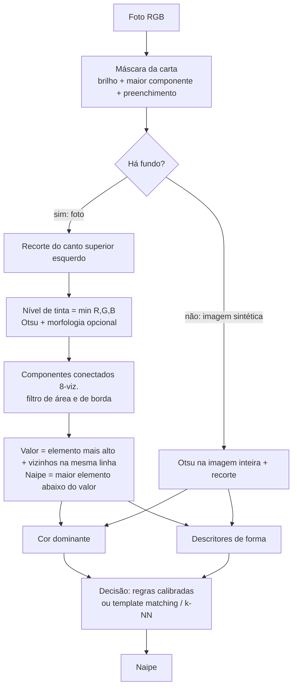
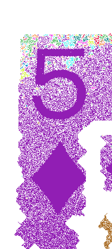
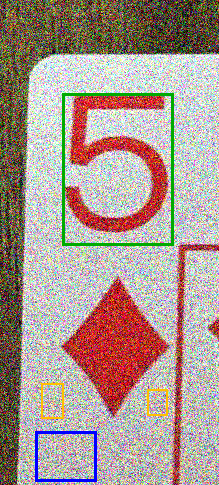
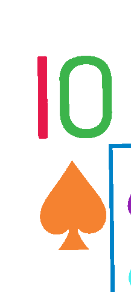
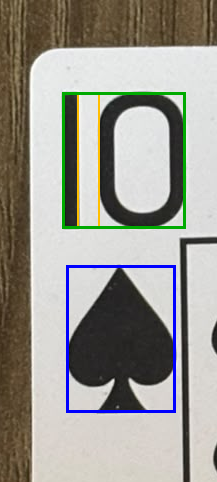
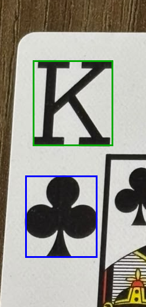
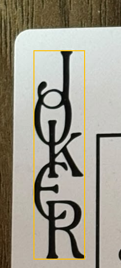

# Relatório parcial — Etapa M2

Projeto aplicado longitudinal — Processamento de Imagens, 2026-02.
Identificação do naipe em cartas de baralho.

## 1. Síntese do problema e objetivos atuais

Dada uma foto de uma carta de baralho francês, tirada de cima sobre uma mesa, o sistema deve identificar o naipe: **copas, ouros, espadas ou paus**. O valor da carta (A–K) é localizado no canto, mas ainda não é reconhecido.

**Objetivo geral:** identificar o naipe em fotos reais a partir do índice do canto (valor + símbolo), com um pipeline clássico de PDI explicável e verificável.

**Objetivos específicos da M2:**

1. Trocar a base de avaliação das imagens sintéticas por fotos reais do baralho do grupo.
2. Separar o conjunto de ajuste do conjunto de teste antes de recalibrar qualquer limiar.
3. Segmentar o canto da carta, separando o valor, o símbolo do naipe e os demais elementos.
4. Comparar regras, template matching e k-NN nas mesmas imagens.
5. Medir o efeito da morfologia na segmentação com imagens degradadas.

**Critério de sucesso:** acurácia por naipe no conjunto de teste, com matriz de confusão publicada. Na segmentação, o critério é a proporção de símbolos localizados com IoU ≥ 0,5 em relação à referência.

## 2. Resposta à devolutiva da M1 e evolução

| Orientação da devolutiva | Ação tomada | Evidência |
|---|---|---|
| Fotografar cartas reais; as sintéticas não podem ser a base da avaliação | 108 fotos reais: 52 cartas × 2 fotos + 4 coringas. Toda a avaliação passou a usar só as fotos reais | `images/input/reais/`, commit `d2533cb` |
| Definir a divisão ajuste/teste antes de recalibrar | Divisão estratificada por naipe e agrupada por carta, congelada em arquivo antes da calibração | `src/split.py`, `images/split_reais.json`, commits `2a45231` e `2a7d885` |
| Adaptar a segmentação ao canto, com valor, símbolo e múltiplos elementos | Localização da carta, recorte do canto, componentes conectados, agrupamento do valor (ex.: "1" + "0") e escolha do símbolo | `src/segmentation.py`, commits `3a5faf1` e `3c62dad` |
| Comparar regras, template matching e k-NN nas mesmas imagens | Os três métodos são ajustados no mesmo conjunto de ajuste e avaliados no mesmo teste | `src/compare.py`, `images/results/comparacao_metodos.json`, commit `12c209c` |
| Remover `.idea/` e melhorar o histórico | `.idea/` removido e ignorado; cada mudança em commit próprio com mensagem descritiva | commit `3f751f4` e histórico a partir de `2a45231` |
| Mermaid inválido na seção de alternativas | Bloco corrigido com cerca `mermaid` e `flowchart` | `docs/proposta.md`, commit `869f8ac` |
| Prioridade: executar sem ajuste manual por imagem em um conjunto real congelado e publicar a matriz de confusão | O pipeline roda igual para todas as imagens, sem parâmetro por imagem; a matriz por naipe está publicada | `images/results/avaliacao_reais.json` |

**Mantido desde a M1:** o escopo (só o naipe), a conversão explícita para RGB, Otsu implementado manualmente, a regra de cor dominante e os três descritores de forma.

**Corrigido:** a segmentação, que antes usava a imagem inteira e agora usa o canto da carta. Os limiares saíram das sintéticas e passaram a vir da calibração. A regra das cartas pretas inverteu de sentido, como mostra o Experimento 1.

**Substituído:** a avaliação com 20 imagens sintéticas pela avaliação com fotos reais. As sintéticas continuam só como teste de regressão.

O registro da M1 está em [`docs/README_M1.md`](README_M1.md).

## 3. Dados e protocolo experimental

### 3.1 Origem e aquisição

- **Origem:** baralho físico de plástico de um integrante do grupo. Sem restrição de redistribuição; as fotos estão no repositório.
- **Aquisição:** fotos de celular, de cima, carta inteira visível sobre uma mesa de madeira, luz ambiente sem controle. Resolução 960 × 1280 px, JPEG (exportação do WhatsApp).
- **Quantidade:** 108 fotos. São as 52 cartas, cada uma fotografada 2 vezes, mais 4 coringas (2 pretos e 2 coloridos).
- **Nomes:** `naipe_valor_nn.jpg`, por exemplo `copas_Q_01.jpg`.

### 3.2 Situações típicas e difíceis presentes

| Situação | Exemplos |
|---|---|
| Típica: carta reta, boa luz | `paus_5_01.jpg`, `ouros_4_02.jpg` |
| Sombra sobre parte da carta | `copas_A_01.jpg`, `espadas_Q_01.jpg` |
| Carta inclinada | `paus_J_01.jpg`, `copas_A_01.jpg` |
| Carta de cabeça para baixo | `copas_10_01.jpg` |
| Valor com dois elementos (10) | `*_10_*.jpg` |
| Figuras (J, Q, K) com desenho perto do índice | `paus_K_01.jpg`, `copas_Q_01.jpg` |
| Carta sem naipe (coringa) | `coringa_preto_01.jpg` |

### 3.3 Referência de avaliação

A referência é o **rótulo manual** de naipe e valor de cada foto, conferido visualmente uma a uma e registrado no nome do arquivo.

- **Limites:** o rótulo diz o naipe, mas não traz máscara nem caixa desenhada à mão do símbolo.
- **Referência de localização:** nos experimentos com ruído, a caixa do símbolo encontrada na foto original (sem ruído) serve de referência. Isso é válido porque essa caixa foi conferida visualmente nas 104 fotos com naipe (Seção 4.3).
- **Coringas:** ficam fora da avaliação de naipe, porque não têm naipe. Eles são usados como caso de falha esperada.

### 3.4 Divisão ajuste/teste

O método não tem treinamento por gradiente. Ainda assim, os limiares, os templates e os vizinhos do k-NN são **ajustados** com dados, e por isso as imagens foram separadas antes de qualquer calibração (`python -m src.split reais`, semente 42):

- **Ajuste:** 8 cartas por naipe, 64 fotos.
- **Teste:** 5 cartas por naipe, 40 fotos. Cartas do teste: copas 3, 7, 8, A, Q; espadas 3, 6, 7, 8, 9; ouros 4, 8, 9, J, K; paus 3, 8, 9, K, Q.

As duas fotos da mesma carta são quase idênticas, então **ficam sempre no mesmo conjunto**. Assim nenhuma carta usada no ajuste reaparece no teste, o que inflaria o resultado.

### 3.5 Tamanho do conjunto

São 4 classes e o problema é bem delimitado. O baralho tem 13 cartas por naipe, e o conjunto cobre todas elas, inclusive as figuras. Com 5 cartas por naipe no teste, cada erro custa 2,5 pontos percentuais. Isso basta para separar métodos com comportamento muito diferente, mas não diferencia métodos que acertam quase tudo (ver Seção 7).

## 4. Pipeline implementado



| Etapa | Arquivo | Entrada | Saída | Parâmetros |
|---|---|---|---|---|
| Carregamento | `preprocessing.py` | caminho | array RGB `uint8` | conversão explícita para RGB |
| Máscara da carta | `segmentation.card_mask` | RGB | máscara booleana | papel: `min(R,G,B) ≥ 115`; escala 1/4 |
| Recorte do canto | `segmentation.corner_region` | RGB + máscara | recorte + região útil | 28% da largura × 45% da altura da carta; folga de 6%; borda descartada de 1,5% |
| Binarização | `segmentation.corner_elements` | recorte | máscara de tinta | Otsu manual sobre `min(R,G,B)` |
| Morfologia | `segmentation.opening` / `closing` | máscara | máscara | elemento estruturante em cruz 3×3, raio 1; desligada por padrão |
| Componentes | `segmentation.connected_components` | máscara | rótulos + caixas + áreas | 8-vizinhança; área mínima 0,2% do recorte; descarta o que toca a borda direita/inferior |
| Valor e naipe | `segmentation.split_value_and_symbol` | componentes | grupo do valor, componente do naipe | ver Seção 5.3 |
| Cor | `segmentation.dominant_color` | pixels do símbolo | vermelho / preto | `R − (G+B)/2 > 15` |
| Forma | `features.py` | máscara do símbolo | 3 descritores | ver Seção 5.4 |
| Decisão | `classify.py`, `compare.py` | cor + descritores | naipe | `images/results/limiares_reais.json` |

**Já funciona:** tudo o que está acima, de ponta a ponta, sem ajuste manual por imagem.

**Pendente (M3):**
- reconhecer o valor da carta, que hoje só é localizado;
- tornar a segmentação robusta a ruído forte e a outros fundos;
- validar com fotos novas, de outro baralho, outro fundo e outra luz.

## 5. Fundamentação das técnicas e parâmetros

### 5.1 Localização da carta

O papel é claro e pouco saturado; a madeira é escura. Medimos o canal mínimo nas bordas de 12 fotos:
- **Madeira:** percentil 95 do canal mínimo ≤ 91.
- **Papel:** percentil 5 ≥ 105, mesmo com sombra.

O limiar 115 fica entre os dois. O maior componente claro é a carta, e preencher os buracos devolve a tinta para dentro da máscara. O cálculo é feito em 1/4 da resolução, porque basta para achar o contorno e é 16 vezes mais barato.

### 5.2 Canto e binarização

O índice (valor + símbolo) aparece repetido e na mesma orientação nos cantos superior esquerdo e inferior direito. Por isso, uma carta de cabeça para baixo continua mostrando um índice legível no canto superior esquerdo da foto.

O canto é ancorado no vértice da carta (mínimo de `x + y`), e não na caixa envolvente, o que tolera cartas inclinadas. Usamos `min(R,G,B)` como nível de tinta porque ele é baixo tanto para tinta preta quanto para vermelha, e alto para o papel. Com isso, um único Otsu separa as duas cores.

### 5.3 Componentes, valor e naipe

- **Componentes de borda:** os que tocam a borda direita ou inferior do recorte são a moldura central ou o desenho das figuras e são descartados.
- **Valor:** é o elemento mais alto mais os elementos que se sobrepõem a ele verticalmente e estão a até uma altura de distância. Assim o "1" e o "0" do 10 viram um único valor.
- **Naipe:** é o **maior** elemento abaixo do valor que se sobrepõe a ele horizontalmente. A versão anterior escolhia o mais próximo e às vezes pegava ruído (Seção 7.2).

### 5.4 Descritores (atributo, unidade, cálculo)

Todos são calculados sobre a máscara binária do símbolo recortada com 5 px de margem. São adimensionais e independem da escala da foto.

| Atributo | Unidade | Cálculo | Intuição |
|---|---|---|---|
| `fill_ratio` | razão, 0–1 | pixels do símbolo ÷ área do recorte | ouros (losango) ocupa menos da caixa |
| `vertical_symmetry` | razão, 0–1 | fração de pixels iguais entre a metade de cima e a de baixo espelhada | ouros é simétrico em cima e embaixo |
| `width_profile_ratio` | razão, > 0 | largura média das linhas da metade de cima ÷ da metade de baixo | copas é largo em cima; espadas é afilado em cima |

Médias nas 26 fotos de cada naipe (`images/results/tabela_features.csv`):

| Naipe | fill_ratio | vertical_symmetry | width_profile_ratio | altura do símbolo (px) |
|---|---:|---:|---:|---:|
| copas | 0,532 | 0,577 | 2,254 | 124 |
| ouros | 0,399 | 0,969 | 1,041 | 141 |
| espadas | 0,500 | 0,788 | 0,695 | 145 |
| paus | 0,465 | 0,774 | 0,909 | 132 |

### 5.5 Calibração das regras

Para cada cor, `src/calibrate.py` testa os três descritores, todos os pontos médios entre valores consecutivos e os dois sentidos da regra. Ele fica com o que mais acerta no **ajuste** e, no empate, com a maior folga entre o limiar e a amostra mais próxima. O resultado:

- **vermelho:** `width_profile_ratio > 1,647` → copas, senão ouros;
- **preto:** `width_profile_ratio > 0,801` → paus, senão espadas.

## 6. Experimentos

Todos os experimentos usam a mesma divisão (`images/split_reais.json`), as mesmas 40 fotos de teste e os mesmos parâmetros, exceto a variável estudada. O ruído é gaussiano, com semente fixa por imagem (`7 + índice`), e por isso é reproduzível. Para reproduzir tudo:

```bash
python -m src.split reais
python -m src.calibrate
python -m src.compare
python -m src.experiments
python -m src.visualize
```

### Experimento 1 — Os limiares das sintéticas servem para fotos reais?

- **Pergunta:** as regras ajustadas nas imagens sintéticas generalizam para fotos?
- **Configuração:** A = regras da M1 (`vertical_symmetry > 0,75`; `width_profile_ratio < 0,9 → paus`); B = regras calibradas no conjunto de ajuste. A segmentação é a mesma.
- **Imagens:** as 40 fotos de teste.
- **Saída:** `images/results/experimentos.json` → `experimento_1_limiares`.

| Configuração | Acertos | Acurácia |
|---|---:|---:|
| A — limiares sintéticos | 23/40 | 57,5% |
| B — limiares calibrados no ajuste | 40/40 | 100% |

Matriz de confusão de A (linhas = esperado, colunas = previsto):

| | copas | espadas | ouros | paus |
|---|---:|---:|---:|---:|
| copas | 10 | 0 | 0 | 0 |
| espadas | 0 | 0 | 0 | **10** |
| ouros | 0 | 0 | 10 | 0 |
| paus | 0 | **7** | 0 | 3 |

**Interpretação:** nas cartas vermelhas a regra antiga ainda funciona. Nas pretas ela está **invertida**: o espadas desenhado no gerador sintético era mais largo em cima que o real. Nas fotos, espadas é afilado em cima (0,695) e paus fica perto de 0,909. Esse é o principal motivo da devolutiva para trocar a base de avaliação.

**Sucesso:** a configuração B acerta as 40 fotos. **Falha:** a configuração A erra todas as espadas.

### Experimento 2 — A abertura morfológica ajuda a segmentar com ruído?

- **Pergunta:** uma abertura (raio 1) na máscara de tinta do canto remove o ruído sem destruir o valor e o símbolo?
- **Configuração:** sem morfologia × com abertura, em três níveis de ruído gaussiano (σ = 0, 30, 60). Regras calibradas fixas.
- **Imagens:** as 40 fotos de teste, com ruído adicionado de forma reproduzível.
- **Indicadores:**
  - fotos sem falha de segmentação;
  - IoU médio entre a caixa do naipe e a caixa encontrada na foto sem ruído;
  - proporção de naipes localizados com IoU ≥ 0,5;
  - acerto de cor e de naipe.

| σ | Morfologia | Segmentadas | IoU médio | Localizados (IoU ≥ 0,5) | Cor | Naipe |
|---:|---|---:|---:|---:|---:|---:|
| 0 | nenhuma | 40/40 | 1,00 | 100% | 100% | 100% |
| 0 | abertura | 40/40 | 1,00 | 100% | 100% | 100% |
| 30 | nenhuma | 40/40 | 0,98 | 100% | 100% | 100% |
| 30 | abertura | 40/40 | 0,99 | 100% | 100% | 100% |
| 60 | nenhuma | 13/40 | 0,22 | 27,5% | 27,5% | 27,5% |
| 60 | abertura | 32/40 | 0,57 | 60% | 70% | 62,5% |

**Interpretação:**
- Sem ruído, a abertura não atrapalha: o IoU fica em 1,00.
- Com σ = 60, sem morfologia, o ruído no papel liga o valor e o símbolo à moldura ou à borda do recorte. Os componentes são descartados e a segmentação falha em 27 das 40 fotos.
- A abertura remove os pontos isolados e mais que dobra a localização correta, de 27,5% para 60%.
- O acerto de naipe (62,5%) é um pouco maior que a localização (60%). Ou seja, em uma foto o naipe saiu certo mesmo com o símbolo mal localizado. Por isso a métrica de localização é a mais confiável aqui.

Figura 1 — `ouros_5_01.jpg` com ruído σ = 60. À esquerda, os componentes sem morfologia: o ruído forma uma única mancha ligada à borda e nada sobra no canto. À direita, com abertura, o valor "5" é encontrado (verde); o losango ainda encosta na moldura e se perde, e a caixa azul fica sobre um resto de ruído. É um caso de falha que o IoU detecta e a simples ausência de erro não detectaria.

| sem morfologia | com abertura |
|---|---|
|  |  |

### Experimento 3 — Regras × template matching × k-NN

- **Pergunta:** algum método de decisão é melhor que as regras sobre a mesma segmentação?
- **Configuração:**
  - **Regras:** Seção 5.5.
  - **Template matching:** a máscara do símbolo é redimensionada para 32 × 32. O template é a média das máscaras de cada naipe no ajuste, e vence o naipe de menor diferença absoluta média, entre os da cor detectada.
  - **k-NN:** k = 3 sobre os 3 descritores padronizados com a média e o desvio do ajuste, entre os vizinhos da cor detectada.
- **Imagens:** os mesmos 64 de ajuste e 40 de teste, com e sem ruído (sem morfologia).
- **Saída:** `images/results/comparacao_metodos.json` e `experimento_3_metodos_com_ruido`.

| σ | Regras | Template matching | k-NN | Falhas de segmentação |
|---:|---:|---:|---:|---:|
| 0 | 100% | 100% | 100% | 0 |
| 30 | 100% | 100% | 97,5% | 0 |
| 60 | 27,5% | 27,5% | 20% | 27 |

Tempo médio só da decisão, por imagem: regras 0,0005 ms; template 0,12 ms; k-NN 0,03 ms. O tempo não é o critério de qualidade e aparece só como registro.

**Interpretação:**
- Nas fotos limpas os três métodos empatam em 100%. Com 5 cartas por naipe no teste, o conjunto não tem poder para separar métodos tão bons.
- O k-NN é o primeiro a errar com ruído moderado (1 foto em σ = 30). A hipótese é que ele usa os três descritores, e `fill_ratio` e `vertical_symmetry` são mais sensíveis ao ruído na borda do símbolo que `width_profile_ratio`.
- Em σ = 60 o gargalo é a segmentação (27 falhas), e não a decisão.

**Decisão:** manter as regras, que são as mais simples e explicáveis e empatam ou superam as alternativas.

## 7. Falhas, limitações e riscos

### 7.1 Casos de sucesso e de falha (saídas intermediárias)

Em `images/results/intermediarias/<foto>/`, cada caso tem:
1. a máscara da carta;
2. o recorte do canto;
3. os componentes rotulados, cada um com uma cor;
4. o valor (verde), o naipe (azul) e os demais elementos (amarelo);
5. a máscara do símbolo.

Figura 2 — Sucesso em `espadas_10_01.jpg`. Os componentes rotulados mostram o "1" e o "0" como elementos separados, e a moldura é descartada por tocar a borda. O valor agrupa os dois dígitos e o naipe é o espadas logo abaixo.

| componentes rotulados | valor e naipe |
|---|---|
|  |  |

Figura 3 — Sucesso em `paus_K_01.jpg`. O desenho da figura entra no recorte, mas toca a borda e é descartado; o naipe é encontrado.



Figura 4 — Falha esperada em `coringa_preto_01.jpg`. As letras "JOKER" estão empilhadas e não há símbolo de naipe abaixo do valor. A segmentação gera um erro explícito ("Nenhum símbolo de naipe encontrado abaixo do valor") em vez de inventar um naipe.



### 7.2 Problemas encontrados durante o desenvolvimento

- **Valor 10 partido:** o agrupamento original usava a largura do "1" para decidir a distância até o próximo dígito. Como o "1" é estreito, o "0" ficava de fora. Corrigido usando a altura do dígito (commit `3c62dad`).
- **Ruído escolhido como naipe:** a regra "elemento mais próximo abaixo do valor" pegava pontos de ruído. Corrigido para "maior elemento abaixo do valor" (mesmo commit). A falha da Figura 1 mostra que isso ainda não basta com ruído forte.

### 7.3 Limitações e riscos

- **Um único ambiente:** um baralho, uma mesa, uma luz. Os 100% no teste não garantem o mesmo resultado com outro fundo (por exemplo, claro, onde `min(R,G,B) ≥ 115` não separa a carta) ou com outra fonte tipográfica.
- **Teste pequeno:** são 40 fotos, 5 cartas por naipe. Cada erro custa 2,5 pontos percentuais e o conjunto não separa métodos muito bons.
- **Inclinação:** o canto tolera inclinação moderada, mas não foi testado com cartas muito rotacionadas, em perspectiva ou parcialmente cobertas.
- **Referência de localização:** é automática (caixa da foto limpa, conferida visualmente), e não uma máscara desenhada à mão.
- **Coringas:** são rejeitados por falta de símbolo, e não reconhecidos como coringa.

## 8. Plano de conclusão para a M3

| Tarefa | Responsável | Evidência esperada |
|---|---|---|
| Fotografar um segundo conjunto (outro fundo e outra luz, cartas inclinadas) e usá-lo só como teste externo | Vinicius Lohn Ramires | novas fotos em `images/input/`, acurácia e matriz de confusão |
| Criar máscaras de referência manuais do símbolo para parte das fotos e medir Dice/IoU | Guilherme Pires | máscaras em `images/reference/`, tabela de IoU |
| Tornar a segmentação robusta a ruído forte (abertura com raio adaptado, filtro de mediana antes de Otsu) | Guilherme Pires | Experimento 2 repetido com σ = 60 |
| Reconhecer o valor da carta (template matching dos dígitos e letras já localizados) | Vinicius Lohn Ramires | acurácia por valor e matriz 13 × 13 |
| Detectar o coringa como classe própria | Vinicius Lohn Ramires | coringas classificados corretamente |
| Atualizar relatório, README e gravar o vídeo da M3 | Guilherme Cassettari (revisão), todos (vídeo) | `docs/relatorio_m3.md`, link do vídeo |

## 9. Contribuições dos integrantes

Ver [`docs/contribuicoes.md`](contribuicoes.md).

## 10. Referências

- OTSU, N. A threshold selection method from gray-level histograms. *IEEE Transactions on Systems, Man, and Cybernetics*, v. 9, n. 1, p. 62–66, 1979.
- GONZALEZ, R. C.; WOODS, R. E. *Processamento Digital de Imagens*. 3. ed. São Paulo: Pearson, 2010. Capítulos de segmentação, morfologia e representação/descrição.
- Material da disciplina de Processamento de Imagens (2026-02), laboratórios M1 e M2.
- Documentação do Pillow (leitura de imagens e redimensionamento) e do NumPy (operações em arrays).
- Recomendação ITU-R BT.601 (0,299 R + 0,587 G + 0,114 B), usado na conversão para cinza das imagens sintéticas.

## 11. Declaração de uso de IA

Ver [`AI_USAGE.md`](../AI_USAGE.md).
